<p align="center">
  
</p>

<p align="center">
  <a href="https://dbdoco.github.io/Portfolio-V2/"></a>
  <a href="https://www.linkedin.com/in/dominik-bedenic-469498136/"></a>
  <a href="mailto:dbdoco@gmail.com"></a>
  <a href="https://mega.nz/file/kER1FRIK#x4fggSeLes0U2Ix1NBnxTwhM8maAHsRRox_gOtPbC78"></a>
</p>

I'm a **software engineer** at [Kupuj Online](https://www.kupujonline.com/), building full-stack products with **.NET** and **Angular** — from APIs and data models to polished UIs. I care about clean architecture, maintainable code, and understanding the problem before writing the solution. I use AI coding tools every day and help my team get real value out of them.


## `stack/`

<table>
  <tr>
    <td align="right" width="18%"><sub><b>CORE</b></sub></td>
    <td></td>
  </tr>
  <tr>
    <td align="right"><sub><b>ALSO</b></sub></td>
    <td></td>
  </tr>
  <tr>
    <td align="right"><sub><b>AI TOOLING</b></sub></td>
    <td>
      
      
      
      
      
    </td>
  </tr>
</table>

## `git log --oneline`

```text
a7f3c91 (HEAD -> main)  now   Software engineer @ Kupuj Online — .NET & Angular
5e2b8d4                 2025  feat: MSc Informatics — Intelligent & Interactive Systems
c91a0f7 (tag: winner)   2024  feat: won RI-HACK, Rijeka's biggest hackathon
3d6e1b2                 2023  feat: BSc Informatics — Software Engineering
0000001                 2017  first commit: hello world in C++
```

<p align="center"><sub><b>✻ Session complete.</b></sub></p>
